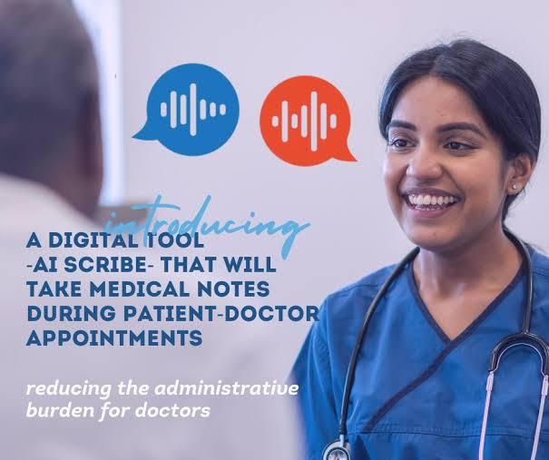

## Generative AI in Healthcare

Generative AI can help healthcare professionals with administrative tasks by turning patient conversations into clinical notes. For example, Abridge records appointments with patient consent and uses AI to create structured medical documentation that doctors can review and add to electronic health records.

This can reduce paperwork, save time, and allow doctors to focus more on their patients. However, it also raises concerns about patient privacy, data security, and inaccurate medical documentation.

<iframe
    style="width:100%; aspect-ratio:16/9; border:0; border-radius:10px;"
    src="https://www.youtube.com/embed/qfBo-EES5-Q"
    title="YouTube video player"
    allowfullscreen>
</iframe>
