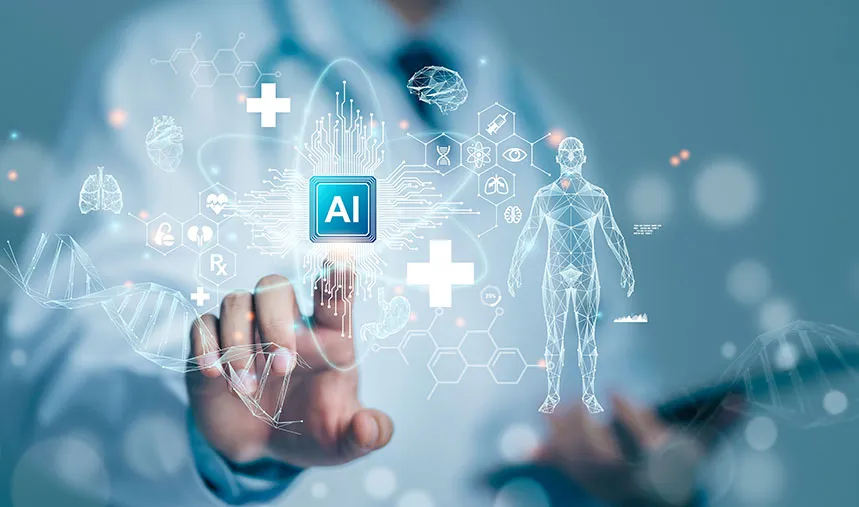

## Introduction to Artificial Intelligence in Healthcare

Over the last two decades, there have been major technological advancements in the medical industry across a variety of applications. One technology that has significantly changed how medicine is practiced is artificial intelligence (AI).

AI in healthcare uses machine learning, data analytics, and natural language processing to analyze medical information, identify patterns, predict potential health outcomes, and automate administrative tasks. These systems can analyze information such as a patient's medical history, genetic information, laboratory results, medical images, and lifestyle habits.
Traditionally, healthcare has been largely reactive, meaning that patients often seek medical attention after experiencing symptoms. Predictive AI allows medical professionals to take a more proactive approach by identifying risk factors, developing personalized treatment plans, and implementing preventative measures. Additionally, generative AI can assist medical professionals with administrative responsibilities, such as documenting patient visits and organizing medical records.

While these technologies have the potential to improve patient outcomes, reduce healthcare costs, and increase the efficiency of medical services, they also introduce ethical concerns regarding patient privacy, data security, algorithmic bias, accuracy, and accountability.
